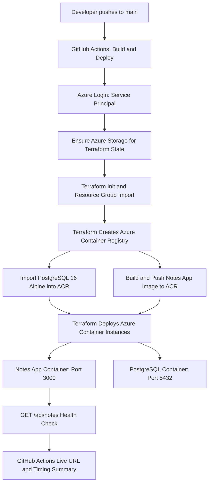

# Notes App — Azure CI/CD Deployment

   

## Project Overview

This project automates the build and deployment of a Dockerized **Node.js/Express Notes App** backed by **PostgreSQL 16** to **Azure Container Instances (ACI)**. The GitHub Actions workflow, **Build and Deploy**, provisions and manages infrastructure with Terraform, stores images in Azure Container Registry (ACR), checks application availability, and reports the live endpoint and deployment duration.

**Repository:** [payo26/lexszy-note-app](https://github.com/payo26/lexszy-note-app)  
**Deployment region:** `eastus`  
**Workflow:** `Build and Deploy`

## Architecture



## Technology Stack

| Layer | Technology | Purpose |
| --- | --- | --- |
| Application | Node.js / Express | Notes API |
| Database | PostgreSQL 16 Alpine | Notes data |
| Containers | Docker | Package the application |
| Registry | Azure Container Registry | Store Notes App and PostgreSQL images |
| Hosting | Azure Container Instances | Run application and database containers |
| Infrastructure | Terraform | Provision and manage Azure resources |
| State | Azure Blob Storage | Remote Terraform state |
| CI/CD | GitHub Actions | Automated deployment and manual cleanup |
| Authentication | Microsoft Entra service principal | Authenticate workflow to Azure |

## Workflow Configuration

The workflow contains these settings:

| Variable | Value |
| --- | --- |
| `LOCATION` | `eastus` |
| `MAIN_RESOURCE_GROUP` | `notes-app-rg` |
| `STATE_RESOURCE_GROUP` | `notes-app-rg` |
| `STATE_STORAGE_ACCOUNT` | `notesvaultstate2510` |
| `STATE_CONTAINER` | `tfstate` |
| `TF_DIR` | `.` |
| `IMAGE_NAME` | `notes-app` |
| `BUILD_CONTEXT` | `.` |
| `APP_PORT` | `3000` |
| `REGISTRY_TARGET` | `-target=azurerm_container_registry.acr` |
| `CONTAINER_GROUP_ADDRESS` | `azurerm_container_group.notes_app` |
| `ADDRESS_OUTPUT` | `container_group_fqdn` |
| `ADDRESS_OUTPUT_FALLBACK` | `container_instance_ip` |

### Triggers

- **Automatic:** Push to the `main` branch.
- **Manual:** GitHub Actions → **Build and Deploy** → **Run workflow** → choose `deploy` or `destroy`.

The workflow uses `deploy-notes-app` as its concurrency group and does not cancel an in-progress run.

## Prerequisites

- Azure subscription with permissions to manage the required resources.
- GitHub repository containing the application Dockerfile, Terraform configuration, and workflow file.
- Microsoft Entra application and service principal with the necessary Azure permissions.
- Git, Docker Desktop, Azure CLI, Terraform, and VS Code for local development and troubleshooting.

Verify local tools:

```powershell
git --version
docker --version
docker compose version
az version
terraform version
```

Clone the project:

```powershell
git clone https://github.com/payo26/lexszy-note-app.git
cd lexszy-note-app
```

## GitHub Actions Secrets

Configure the following under **Repository → Settings → Secrets and variables → Actions**:

| Secret | Description |
| --- | --- |
| `GROUP_ONE_AZURE_CREDENTIALS` | JSON credentials for the Azure service principal |
| `GROUP_ONE_SUBSCRIPTION_ID` | Azure subscription ID |
| `DB_PASSWORD` | PostgreSQL password supplied to Terraform |

The Azure credentials secret uses this structure:

```json
{
  "clientId": "<APPLICATION_CLIENT_ID>",
  "clientSecret": "<CLIENT_SECRET_VALUE>",
  "subscriptionId": "<AZURE_SUBSCRIPTION_ID>",
  "tenantId": "<TENANT_ID>"
}
```

### Create the Service Principal Client Secret

Sign in to Azure using an account authorized to manage the application registration:

```powershell
az login

$appId = az ad app list `
  --display-name "notes-app-github-cicd" `
  --query "[0].appId" -o tsv

az ad app credential reset `
  --id $appId `
  --append `
  --display-name "notes-app-github-cicd-secret" `
  --years 1
```

Use the generated **password value** as `clientSecret` in the GitHub secret. The workflow uses `azure/login@v2` to authenticate with this JSON credential.

## Deployment Procedure

### 1. Checkout and Start Timer

The workflow records its start time and checks out the repository using `actions/checkout@v4`.

### 2. Determine Image Tagging Mode

The workflow scans Terraform files for `var.image_tag`:

- **Variable-based tag:** `IMAGE_MODE=tag`, moving tag `latest`.
- **Fixed image tag:** `IMAGE_MODE=replace`, using the tag found in the Terraform files. When an existing container group is tracked in Terraform state, this mode applies `-replace=azurerm_container_group.notes_app`.

The deployment job sets `TF_VAR_image_tag` to the GitHub commit SHA and `TF_VAR_deploy_containers` to `true`.

### 3. Authenticate to Azure

The workflow logs in using:

```yaml
- name: 2. Log in to Azure
  uses: azure/login@v2
  with:
    creds: ${{ secrets.GROUP_ONE_AZURE_CREDENTIALS }}
```

It checks that the credentials' subscription ID matches `GROUP_ONE_SUBSCRIPTION_ID` and exports `ARM_CLIENT_ID`, `ARM_CLIENT_SECRET`, `ARM_SUBSCRIPTION_ID`, `ARM_TENANT_ID`, and `TF_VAR_subscription_id` for Terraform.

### 4. Check Existing Azure Resources

The workflow reports whether these resources already exist:

- Resource group: `notes-app-rg`
- Terraform state storage account: `notesvaultstate2510`
- An Azure Container Registry in `notes-app-rg`

### 5. Set Up Terraform and Azure Providers

The workflow installs Terraform using `hashicorp/setup-terraform@v3`, with a version constraint below 2.0.0 and `terraform_wrapper: false`.

It checks registration of these Azure resource providers:

```text
Microsoft.Storage
Microsoft.ContainerRegistry
Microsoft.ContainerInstance
```

Unregistered providers are registered using Azure CLI.

### 6. Ensure Remote Terraform State Storage

The workflow creates the state resource group if absent, then creates `notesvaultstate2510` if needed using:

- `Standard_LRS`
- `StorageV2`
- Minimum TLS version 1.2
- Blob public access disabled

It retrieves a storage account key and ensures that the `tfstate` blob container exists.

### 7. Initialize Terraform

The workflow runs:

```bash
terraform init -input=false
```

Initialization is retried up to five times, with a 30-second pause after a failed attempt.

### 8. Import Existing Resource Group

If `notes-app-rg` exists in Azure but is not in Terraform state, and the Terraform configuration contains `azurerm_resource_group.rg`, the workflow imports it:

```bash
terraform import -input=false \
  azurerm_resource_group.rg \
  "/subscriptions/$AZURE_SUBSCRIPTION_ID/resourceGroups/$MAIN_RESOURCE_GROUP"
```

### 9. Provision Azure Container Registry

The workflow applies the Terraform ACR target:

```bash
terraform apply -input=false -auto-approve \
  -target=azurerm_container_registry.acr
```

It then discovers the ACR name from the resource group and stores it as `ACR_NAME` for later steps.

### 10. Import PostgreSQL Image into ACR

The workflow checks whether `postgres:16-alpine` is present in ACR. If not, it imports the image from Docker Hub:

```bash
az acr import \
  --name "$ACR_NAME" \
  --source docker.io/library/postgres:16-alpine \
  --image postgres:16-alpine \
  --force
```

Import attempts are retried up to five times, with 30-second intervals after failures.

### 11. Build and Push Notes App Image

The workflow logs in to ACR, builds the application image with a commit-SHA tag and a moving tag, and pushes both:

```bash
az acr login --name "$ACR_NAME"
IMAGE="$ACR_NAME.azurecr.io/$IMAGE_NAME"
docker build -t "$IMAGE:$GITHUB_SHA" -t "$IMAGE:$MOVING_TAG" "$BUILD_CONTEXT"
docker push "$IMAGE:$GITHUB_SHA"
docker push "$IMAGE:$MOVING_TAG"
```

The Notes App image is built from the repository's configured Docker build context.

### 12. Deploy the Container Group

The workflow runs Terraform to deploy or update the ACI container group:

```bash
terraform apply -input=false -auto-approve $REPLACE
```

In fixed-tag replacement mode, `$REPLACE` may contain `-replace=azurerm_container_group.notes_app`.

The application uses port `3000`; the accompanying PostgreSQL container uses port `5432`.

### 13. Verify the Live Application

The workflow reads the application address from the Terraform output `container_group_fqdn`, falling back to `container_instance_ip` if needed.

It constructs the live URL and requests:

```text
http://<ACI_ADDRESS>:3000/api/notes
```

The workflow attempts the check up to 60 times, with a 10-second delay between unsuccessful attempts. If the endpoint does not return a successful response within the checking window, the job fails.

### 14. Publish Deployment Summary

When the health check succeeds, GitHub Actions publishes:

| Summary field | Description |
| --- | --- |
| Live URL | Application endpoint |
| Run type | Built from scratch or update of existing deployment |
| Merge to live | Elapsed time from commit timestamp to live verification |
| Pipeline only | Elapsed time from workflow timer start to live verification |

The workflow also prints the live URL in the job logs.

## How to Run a Deployment

### Automatic Deployment

Commit and push changes to `main`:

```powershell
git add .
git commit -m "Update Notes App"
git push origin main
```

This triggers **Build and Deploy**.

### Manual Deployment

1. Open the GitHub repository's **Actions** tab.
2. Select **Build and Deploy**.
3. Click **Run workflow**.
4. Select the `main` branch.
5. Choose `deploy`.
6. Start the workflow and monitor the `build-and-deploy` job.
7. Open the job summary for the live application URL and deployment timing.

## Verify Resources from Azure CLI

Check the resource group:

```powershell
az group show --name notes-app-rg -o table
```

List container registries:

```powershell
az acr list --resource-group notes-app-rg -o table
```

List image repositories:

```powershell
az acr repository list --name <ACR_NAME> -o table
```

List container groups:

```powershell
az container list --resource-group notes-app-rg -o table
```

Inspect the application logs:

```powershell
az container logs `
  --resource-group notes-app-rg `
  --name <CONTAINER_GROUP_NAME> `
  --container-name <APP_CONTAINER_NAME>
```

Inspect PostgreSQL logs:

```powershell
az container logs `
  --resource-group notes-app-rg `
  --name <CONTAINER_GROUP_NAME> `
  --container-name <POSTGRES_CONTAINER_NAME>
```

Check the Notes API:

```powershell
Invoke-RestMethod "http://<ACI_ADDRESS>:3000/api/notes"
```

## Manual Destroy Workflow

The workflow provides a manual `destroy` action with a confirmation step.

1. Open **GitHub → Actions → Build and Deploy → Run workflow**.
2. Select `destroy` as the action.
3. Type `destroy` in the confirmation field.
4. Set the `delete_state` option as desired.
5. Start the workflow.

The `confirm-destroy` job checks the confirmation string. After successful confirmation, the `destroy` job:

1. Checks out the repository.
2. Logs in to Azure with `GROUP_ONE_AZURE_CREDENTIALS`.
3. Exports service principal credentials for Terraform.
4. Initializes Terraform.
5. Runs `terraform destroy -input=false -auto-approve`.
6. Deletes the main resource group if it exists.
7. If `delete_state` is selected, also attempts to delete the state resource group.
8. Verifies cleanup and lists remaining Azure resources.

**Workflow behavior:** Both `MAIN_RESOURCE_GROUP` and `STATE_RESOURCE_GROUP` are set to `notes-app-rg`. The main resource-group deletion therefore includes the Terraform state storage account, regardless of the `delete_state` input. The `delete_state` input defaults to `true`. The resource-group deletion step runs even if the Terraform destroy step reports an error.

## Troubleshooting

| Symptom | Area to inspect |
| --- | --- |
| Azure login fails | `GROUP_ONE_AZURE_CREDENTIALS` JSON, client secret value, tenant and subscription |
| Subscription mismatch | `GROUP_ONE_SUBSCRIPTION_ID`, credentials JSON, Terraform provider configuration |
| Terraform init fails | Backend storage name, state container, service principal permissions |
| Resource group import fails | Terraform resource address and Azure resource ID |
| ACR provisioning fails | Terraform registry configuration, Azure permissions, existing registry |
| PostgreSQL image import fails | ACR import operation and upstream image access |
| Docker push fails | ACR login and image repository permissions |
| Terraform apply fails | Container group configuration, image references, Terraform state |
| `/api/notes` check times out | Application logs, PostgreSQL logs, API startup, database connectivity |
| Notes table missing | Application database initialization or migrations |

## Deployment Checklist

- [ ] Source code and Terraform configuration are in the GitHub repository.
- [ ] `GROUP_ONE_AZURE_CREDENTIALS` is configured.
- [ ] `GROUP_ONE_SUBSCRIPTION_ID` is configured.
- [ ] `DB_PASSWORD` is configured.
- [ ] The workflow authenticates to Azure.
- [ ] Terraform initializes successfully.
- [ ] ACR is available.
- [ ] PostgreSQL image is available in ACR.
- [ ] Notes App image is built and pushed.
- [ ] Terraform deploys the ACI container group.
- [ ] `/api/notes` responds successfully.
- [ ] GitHub Actions displays the live URL and timing summary.

## Project Outcome

The **Build and Deploy** workflow brings together source control, Docker image builds, Azure Container Registry, Terraform-managed infrastructure, Azure Container Instances, PostgreSQL, service principal authentication, and automated endpoint verification. Each deployment is associated with a Git commit SHA, and successful runs publish the application's live address and deployment timing in GitHub Actions.

---

**Documentation basis:** The project's supplied `Build and Deploy` GitHub Actions workflow.
